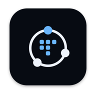
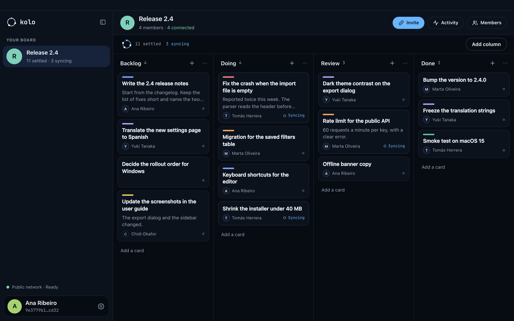

<p align="center"></p>

<h1 align="center">Kolo Board</h1>

<p align="center"><b>An example desktop kanban board for Kolo that several people edit at the same time, each computer syncing straight with the others: only columns and cards, no chat, no comments and no attachments.</b></p>

<p align="center"><a href="https://github.com/ciranda-dev/kolo-board-wails3-example/releases">Download</a> · <a href="docs/how-it-works.md">Docs</a> · <a href="CHANGELOG.md">Changelog</a></p>

<p align="center"><a href="CHANGELOG.md"></a> <a href="LICENSE"></a> <a href="go.mod"></a> <a href="go.mod"></a> <a href="#platforms"></a></p>



## What it does

- **Make a board** with columns and cards (title, description, an assignee, a color), then add, edit, move, reorder and delete them.
- **Invite people** with a code that expires and takes a set number of people, and approve each one or let them in at once.
- **See who is on the board**, who is connected and who is an admin; remove a member, or leave: an admin who leaves is removed for all members, then this computer's copy is deleted.
- **See what is settled**: which cards are settled and which are still syncing, and the list of who did what.
- **Follow other people's changes** from the menu bar or tray, and on a Mac from the notch window.

## Platforms

| Platform | Install | Version | Status |
|---|---|---|---|
| macOS (universal) | `.dmg` or `.zip` | v0.1.1 | Beta, unsigned |
| Windows (amd64, arm64) | installer `.exe`, `.exe` or `.zip` | v0.1.1 | Beta, unsigned |
| Linux (amd64, arm64) | `.deb` or `.tar.gz` | v0.1.1 | Beta, unsigned |

Get the files from the [latest release](https://github.com/ciranda-dev/kolo-board-wails3-example/releases), with `SHA256SUMS` to check them. They are not signed or notarized, so the system warns before the first run. Build your own with `scripts/release-local.sh` (see [build and test](docs/build-and-test.md)).

## Try it

You need Go 1.26 or later, Node.js with npm, and the Wails 3 CLI (`go install github.com/wailsapp/wails/v3/cmd/wails3@v3.0.0`). `go.mod` requires the tagged Kolo libraries (see [build and test](docs/build-and-test.md)). A **peer** is one running copy of the example. An **entry node** is a server every peer contacts first to find the others. Run the commands in the repository folder.

### Two computers, anywhere (the public network)

With no flag the example uses the public network: two entry nodes run by Ciranda, free, with no uptime guarantee while Kolo is a beta. Two people on different networks find each other with nothing to set up. Build the example and make the folder on each computer.

Once: build the example.

```sh
wails3 build
```

Once: make a private folder for the demo data.

```sh
mkdir -p -m 700 /tmp/kolo-board-demo
```

Computer A: Ana.

```sh
./bin/kolo-board -data /tmp/kolo-board-demo/ana
```

Computer B: Bia.

```sh
./bin/kolo-board -data /tmp/kolo-board-demo/bia
```

In Ana's window choose a name, create a board and make an invite. Copy it to B by any means. In Bia's window choose a name, paste the invite and join. Add, move and edit cards in both windows. The peers connect straight to each other through their routers; when two networks block that, a connection relay connects them ([Need a relay or a pin?](#need-a-relay-or-a-pin)).

If the public network cannot be reached when the example starts (no internet, nothing answered), the window says so and names the other two options. The example never falls back to another network by itself.

### Your own network

`-bootstrap` takes the entry nodes of a network of your own and uses them alone: the public network is not touched. Computer A runs the entry node and Ana; computer B runs Bia. `<ip-of-computer-a>` is A's address as B reaches it: a LAN address such as `192.168.1.10` (`ipconfig getifaddr en0` on a Mac, `hostname -I` on Linux), or a public IPv4 address or host name for two networks (see [try it](docs/try-it.md)). Allow UDP port 7447 into A.

Computer A and B, once: install kolo-node (in `$(go env GOPATH)/bin`, which must be on your `PATH`).

```sh
go install github.com/ciranda-dev/kolo-node/cmd/kolo-node@v0.1.1
```

Computer A, terminal 1: the entry node on UDP port 7447. It creates its key file on the first run.

```sh
kolo-node run -listen 0.0.0.0:7447 -identity /tmp/kolo-board-demo/node/node.key -first
```

Computer A, terminal 2: Ana.

```sh
./bin/kolo-board -data /tmp/kolo-board-demo/ana -bootstrap <ip-of-computer-a>:7447
```

Computer B: check that the entry node answers (it prints `ok`), then start Bia.

```sh
kolo-node check <ip-of-computer-a>:7447
```

```sh
./bin/kolo-board -data /tmp/kolo-board-demo/bia -bootstrap <ip-of-computer-a>:7447
```

With an entry node that is not on loopback the example listens on `0.0.0.0:0`. Instead of `-bootstrap` you can set `KOLO_BOOTSTRAP=<ip-of-computer-a>:7447`; Settings shows the network and, for a network of your own, the entry nodes in use (never the public ones). `-first 127.0.0.1:4000` runs an entry node inside one copy for a test network on loopback.

### This computer only

Build the example and make the folder as above. `-local` keeps everything on this computer: the first window runs an entry node on `127.0.0.1:7451` and the others join it. Nothing leaves the computer and no firewall rule is needed. One terminal per person, each with a folder of its own.

Terminal 1: Ana. Keep her copy open: it is the entry node.

```sh
./bin/kolo-board -local -data /tmp/kolo-board-demo/ana
```

Terminal 2: Bia.

```sh
./bin/kolo-board -local -data /tmp/kolo-board-demo/bia
```

Terminal 3, for a third person: Caio.

```sh
./bin/kolo-board -local -data /tmp/kolo-board-demo/caio
```

`KOLO_BOARD_LOCAL=1` does the same as `-local`. It cannot be combined with `-bootstrap` or `-first`: the example stops with an error that names both.

If it does not connect: the copies must use the same network (all with no flag, all with the same `-bootstrap`, or all with `-local`) and UDP must not be blocked between them. More in [try it](docs/try-it.md).

Tests: `go test ./...`. Live reload: `KOLO_BOARD_DATA=/tmp/kolo-board-demo/dev wails3 dev`.

## Need a relay or a pin?

Kolo Board starts from entry nodes. By default they are the public ones, run by Ciranda: free, with no uptime guarantee while Kolo is a beta. For a network of your own give your entry nodes with `-bootstrap` ([Try it](#your-own-network)); for this computer only use `-local`. Run your own entry node with `kolo-node run` on UDP port 7447.

- **Relay**: optional, for two computers behind strict NATs that cannot connect directly. When the direct connection fails, the invite, the join and the board's sync go through it. It passes on what the members send, encrypted end to end, and cannot read it.
- **Pin**: not used. Members sync straight with each other while they are online at the same time.

There is no public relay, and the example never chooses one for you: a relay is needed only behind strict NATs, and you run your own on a host every member reaches, on UDP port 7448. It prints its key when it starts.

```sh
kolo-node relay -listen 0.0.0.0:7448 -identity "$HOME/kolo-node/relay.key"
```

Start every copy with the same relay, `host:port@key` with the key as 64 hex characters. The invite does not carry it.

```sh
./bin/kolo-board -bootstrap <ip-of-computer-a>:7447 -relay <relay-host>:7448@<relay-key>
```

`-relay` repeats or takes a comma list, `-relay-file` reads one or more relays per line and `KOLO_BOARD_RELAYS` is used when neither flag is given. Settings shows each relay's state and which setting gave the list, and a relay listed with a wrong key is reported a few seconds after the start. Commands and ports: [your own servers](docs/own-servers.md).

### With the installed macOS app

The installed app reads `KOLO_BOARD_RELAYS` from its environment, so start it from a terminal with your relay (replace the placeholders with your relay's address and its key, 64 hex characters):

```sh
KOLO_BOARD_RELAYS="<relay-host>:7448@<relay-key>" /Applications/kolo-board.app/Contents/MacOS/kolo-board
```

On other systems, set the same variable in the environment of the process before it starts. The flag `-relay` and the file `-relay-file` work the same way and win over the variable.

## How it uses Kolo

| Kolo library | What the example uses it for |
|---|---|
| [kolo-braid](https://github.com/ciranda-dev/kolo-braid) | the board: every member's signed changes merged into one order that is the same for everyone, and the rules that turn it into columns and cards |
| [kolo-invite](https://github.com/ciranda-dev/kolo-invite) | the invite and the request to join |
| [kolo-swarm](https://github.com/ciranda-dev/kolo-swarm) | finding the other members, and connecting to them directly or through a connection relay |
| [kolo-relay](https://github.com/ciranda-dev/kolo-relay) | why a connection relay holds no place for the example, shown in Settings |
| [kolo-dht](https://github.com/ciranda-dev/kolo-dht) | the network nodes, the list of public entry nodes, and the entry node that `-local` and `-first` run |
| [kolo-secure](https://github.com/ciranda-dev/kolo-secure) | the encrypted connections, and the check of a connection relay's key |
| [kolo-transport](https://github.com/ciranda-dev/kolo-transport) | the QUIC connections, with its default limits: 4 connections from one address and 16 streams each ([security](docs/security.md#strangers-and-memory)) |
| [kolo-store](https://github.com/ciranda-dev/kolo-store) | the board's store and the invites' store, on disk |
| [kolo-codec](https://github.com/ciranda-dev/kolo-codec) | the binary form of every change |
| [kolo-id](https://github.com/ciranda-dev/kolo-id) | the example's identity: the key that signs each change |

## Where the Kolo code is

- `lifecycle.go`: making, opening and joining a board with `kolobraid.Create`, `Open` and `NewJoin`, on a `kolostore` store.
- `apply.go`: the rules that turn the braid's order (`kolobraid.Tx`, `Entry`, `Reject`) into columns and cards.
- `board.go`: one open board: braid events, snapshots, roles and the swarm peers on the board's topic.
- `members.go`: invites and requests with `kolo-invite` and `kolobraid.ParseJoinRequest`, roles and removal.
- `boardservice.go`: the network: identity, swarm (with `Config.Relays`, and `Bootstrap(ctx, nil)` for the public network), DHT node and transport. `serve` hands every board connection, direct or relayed, to `ServeConn`.
- `config.go`: the three networks (the public one by default, `-bootstrap`, `-local`), and `-relay`, `-relay-file` and `KOLO_BOARD_RELAYS`, read with kolo-swarm's `ParseRelays` and `LoadRelays`.
- `relay.go`: the connection relays' states from the swarm's `RelayChanged` events, and the check of each relay's key with one `kolosecure.Dial` at start.

## Project layout

```text
main.go, config.go         start the example; flags, environment variables and defaults
boardservice.go            the methods the window calls, and the network
relay.go                   the connection relays' states, and the check of their keys
lifecycle.go, members.go   making, joining and leaving a board; invites and members
model.go, apply.go         the changes and the rules that turn their order into the board
edit.go, view.go           the edits the window asks for; reading the board
board.go, changes.go       one open board and how it shows to the windows
notch.go, tray.go          what the notch window and the tray show
frontend/                  the window (React)
```

## Learn more

- [Try it on one or two computers](docs/try-it.md), [your own servers](docs/own-servers.md), [how a board works](docs/how-it-works.md), [configuration](docs/configuration.md), [notch and tray](docs/notch-and-tray.md)
- [Security](docs/security.md), [build and test](docs/build-and-test.md), [the service API](docs/api.md)
- [Changelog](CHANGELOG.md), [security policy](SECURITY.md), [license](LICENSE) (Apache-2.0)
