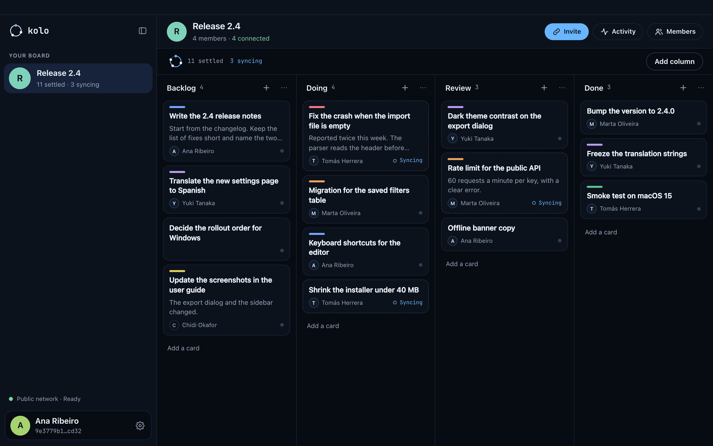
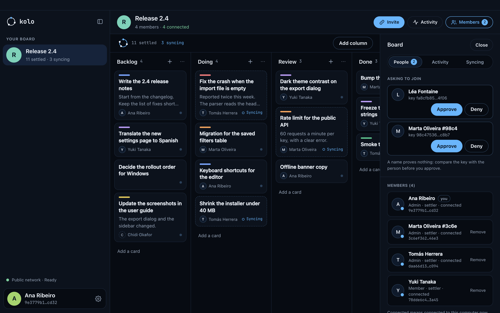

# How a board works

## The flow

1. You choose a name. People see it next to what you do.
2. You **create a board** with a title and columns (To do, Doing and Done by default), or **join** one with an invite.
3. An admin makes an **invite**: a code with a lifetime the admin chooses and a number of uses. It can need approval.
4. The other person pastes the code. Their copy finds the admin's copy, asks to join, and gets the board.
5. Everyone adds, edits, moves and deletes cards and columns. Each change shows at once on your screen and reaches the others.

A **peer** is one running copy of the example. An **entry node** is a server every peer contacts first to find the others. By default these are the public entry nodes run by Ciranda; `-bootstrap` uses your own, and `-local` keeps everything on one computer ([configuration](configuration.md#the-network)).

## One board, many logs

Every member writes changes into their own signed log. kolo-braid merges all the logs into one order that is the same on every computer, and the example turns that order into the board with the rules below (`apply.go`).

## Rules of the board

Every computer applies these rules to the one order, so every computer shows the same board.

1. The order among changes made at the same time is not fair: a settler can try to influence it, so no rule depends on who was first.
2. Per field, the later change in the order wins. Two people editing different fields of one card both take effect.
3. A change to a card or column that was deleted earlier in the order is rejected, so nothing brings it back. A change ordered before the delete goes away with the card.
4. Deleting a column deletes the cards in it. A card added or moved into a deleted column afterwards is rejected; a moved card stays where it was.
5. Cards and columns are ordered by position, chosen between the neighbors the person sees. Two items placed in the same gap at the same time get the same position; the one with the smaller ID goes first.
6. An assignee must be a member at that point of the order. Removing a member later keeps the assignment.
7. Only an admin renames the board. Any member can do everything else to any card or column.
8. A change that breaks a size or format bound is rejected, whatever copy sent it. A rejected change has no effect and is not in the activity list.
9. A column holds about 32,000 cards added at its end, and a gap can be split many hundreds of times. Beyond that, adding or moving there fails with "no room": put it at the start or the end.

## Settled and syncing

The first part of the order is **settled** and never changes. The rest is **syncing**: shown right away, but it can still move when other changes arrive. A card shows as syncing while its latest change is in that part.

A change settles when enough **settlers** are online. A settler is a member whose computer takes part in settling. The example admits every joiner with kolo-braid's `GrowSettlers` option, which decides who: with one or two members, only the creator; with three, all three (two must be online); with four or more, four of them (three must be online). The window shows how many are online. While there are too few, changes stay syncing; none is lost. When members are added, the new settlers take effect after the next change anyone makes.

## What the window shows

- The sidebar, the full height of the window: the Kolo mark and a button that folds it into a narrow rail (the choice is kept on this computer), the board this example holds, one at a time, with how many of its cards are settled and how many are syncing, the network in one quiet line (public network, your own network or this computer only; never the addresses of the entry nodes), and your name, your short key and the button for Settings. Settings opens in the main column.
- The header of the board: its name (an admin renames it by clicking it), how many members it has and how many are connected, and the buttons Invite (admins), Activity and Members.
- The columns and cards, each marked settled or syncing, with the assignee and color.
- The members: name, you, connected now, admin, settler. "Connected" means this computer has a connection to them, direct or through a connection relay.
- The invites and the people waiting for approval, for admins.
- The activity list: who did what, from the order. It lists changes that took effect.

Members, Activity and what settled and syncing mean open in a panel beside the board. In a narrow window the panel opens over the board and Escape closes it.

## Removing and leaving

An admin can remove a member. What they wrote before the removal stays, what they write after it is void for everyone, and the others stop sending them entries. They keep everything they had received.

A removed member is usually not told: the others stop serving it at once. Its window shows the board read only when the removal reaches it; otherwise, when its own changes stay unsettled for a minute while enough settlers are connected, it says they are not syncing and that it may have been removed.

Leaving removes you from the board for all members, then deletes your computer's copy. The window says first what leaving will do:

- An admin is removed on every computer. If no other member was online to receive the removal, the copy stays and the window says the others still list you; leaving again deletes the copy, and an admin can remove you.
- A member that is not an admin cannot remove itself (kolo-braid takes a removal only from an admin): leaving deletes the copy, and an admin removes you.
- The last admin, and the only computer that settles the board, cannot leave while others are on it: remove the others first. Settling is shared once the board has three members.
- Alone on a board, leaving deletes it.

## Deleting

Deleting a card takes it off the board. The change that made it, with its text, stays in every member's history: a board change can never be erased.
